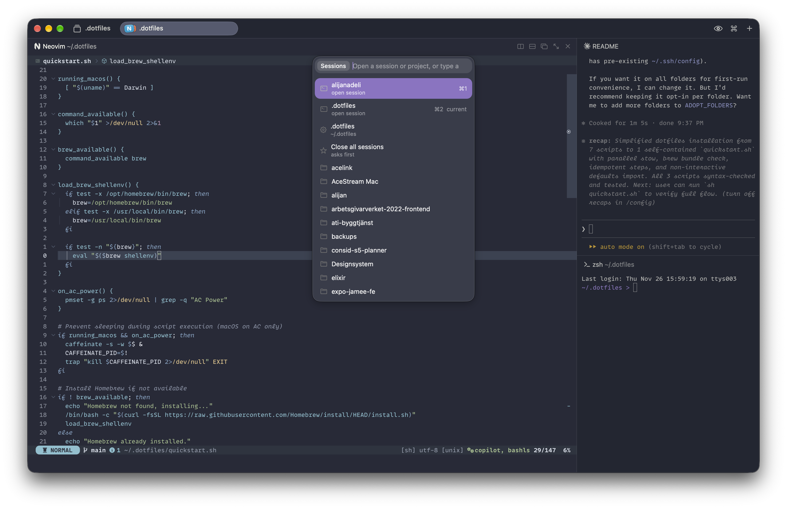

# .dotfiles

This is my dotfiles for MacOS.

> [!NOTE]
> This has only been tested on MacOS.



## Setup

### Install

```
git clone --recursive git@github.com:H4ckint0sh/dotfiles.git ~/.dotfiles
cd ~/.dotfiles
chmod +x quickstart.sh
sh quickstart.sh
```

### Uninstall

Run `./cleanenv` to unlink the configs.

## Apps

- Text editors: [Neovim](https://neovim.io/), [Helix](https://helix-editor.com/), [Zed](https://zed.dev/)
- Terminal emulator: [Ghostty](https://ghostty.org/) (config in `ghostty/`, not yet stowed)
- Terminal multiplexer: [Rex](https://www.superlogical.com/rex) (old tmux config archived in `old/tmux`)
- Window manager: [Rift](https://github.com/acsandmann/rift) (config mirrors [aerospace](https://github.com/nikitabobko/AeroSpace), keep them in sync)
- Git TUI: [lazygit](https://github.com/jesseduffield/lazygit), [gitu](https://github.com/gitu-dev/gitu)
- Shell: [zsh](https://www.zsh.org), [bash](https://www.gnu.org/software/bash/)
- Prompt: [oh-my-posh](https://ohmyposh.dev/)
- Symlink manager: [stow](https://www.gnu.org/software/stow/)
- Better cat: [bat](https://github.com/sharkdp/bat)
- Better ls: [eza](https://github.com/eza-community/eza)
- Key remapping: [karabiner-elements](https://karabiner-elements.pqrs.org/)

## Bin Scripts

Custom scripts in `bin/bin/`:

- `rex-cht` - Rex cheat sheet
- `rex-font` - Rex font management
- `rex-fzf-url` - Rex fzf URL opener
- `rex-session-init` - Rex session initialization
- `rift-aerospace` - Rift/AeroSpace workspace sync
- `of` - Open file with fzf
- `update` - Update dotfiles and packages

## Structure

```
.dotfiles/
├── bash/           # Bash configuration
├── bat/            # bat themes/config
├── bin/            # Custom scripts (stowed to ~/.local/bin)
├── exported-defaults/  # macOS defaults export
├── eza/            # eza configuration
├── git/            # Git configuration
├── gitu/           # gitu configuration
├── helix/          # Helix editor config
├── karabiner/      # Karabiner-Elements config
├── lazygit/        # lazygit config
├── nvim/           # Neovim config (lazy.nvim)
├── ohmyposh/       # oh-my-posh themes
├── rex/            # Rex terminal multiplexer config
├── rift/           # Rift window manager config
├── ssh/            # SSH config
├── wallpapers/     # Wallpaper images
├── zed/            # Zed editor config
├── zsh/            # Zsh configuration
├── install         # Stow installation script
├── linkfolders     # Defines STOW_FOLDERS
├── quickstart.sh   # Main setup script
├── macsetup        # Homebrew/packages setup
├── functions       # Shared shell functions
├── import-defaults.sh  # Import macOS defaults
├── cleanenv        # Unlink all stow folders
├── Makefile        # Build helpers
└── Brewfile        # Homebrew bundle
```